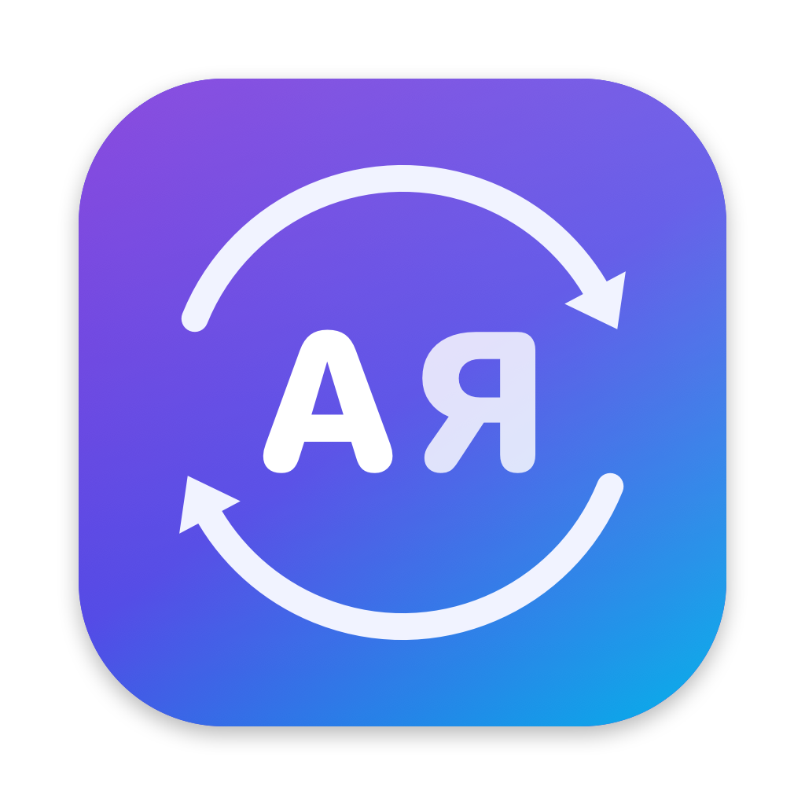

<p align="center"></p>

<h1 align="center">Switchy</h1>

<p align="center">
Fix text typed in the wrong keyboard layout — <b>on demand</b>, not automatically.<br>
A tiny macOS menu-bar utility. No dictionaries to maintain, no network, nothing leaves your Mac.
</p>

<p align="center"><a href="README.ru.md">Русский</a> · <a href="README.uk.md">Українська</a></p>

---

## Features

- **Fix what you just typed.** Typed `ghbdtn` instead of `привет`? Tap **Left Option** — the text is
  retyped in the right layout and the layout is switched.
- **Smart mode.** The first tap picks the most likely layout using macOS built-in spell checking and
  language recognition (on-device). Further taps cycle through the remaining layouts, the original one last.
- **Fix selected text.** Select text and tap the same key.
- **Direct layout hotkeys.** One hotkey per layout (e.g. `⌃⌥1` → English, `⌃⌥2` → Russian, or F13/F14/F15).
  If you have just typed something, it is converted into that layout too.
- **Per-window layout memory.** Every window keeps its own layout — including switches made by Switchy.
- **Clipboard history.** Text only, with a quick picker near the text cursor (`⇧⌘V`): numbers 1–9, search,
  arrows. Passwords marked as sensitive by password managers are never saved.
- **Settings for everything:** hotkeys (shortcuts, modifier taps and double taps), layout order, per-app
  exclusions, pause, launch at login. Interface in English, Russian and Ukrainian.

Works with any keyboard layouts installed in macOS — tables are built from the system layout data.

## Install

1. Download **Switchy-x.y.z.dmg** from [Releases](https://github.com/hdd1/Switchy/releases/latest),
   open it and drag **Switchy** to **Applications**.
2. **First launch.** Switchy is free and not notarized by Apple (that requires a paid developer
   account), so macOS blocks the first launch:
   - open Switchy → in the “Switchy Not Opened” dialog click **Done**;
   - open **System Settings → Privacy & Security**, scroll down to **Security** and click
     **Open Anyway** next to “Switchy was blocked…”, confirm with your password / Touch ID.

   Or, in Terminal: `xattr -dr com.apple.quarantine /Applications/Switchy.app`
3. **Permissions.** Switchy needs **Accessibility** and **Input Monitoring** (to see keystrokes and
   retype text). Allow them when asked, or in **System Settings → Privacy & Security**.
   If Switchy is not in a list, add it with **+** (`/Applications/Switchy.app`).
   The menu-bar indicator shows `⚠︎` until everything is granted.
4. Recommended: turn off **System Settings → Keyboard → Input Sources → Edit… →
   “Automatically switch to a document’s input source”** — Switchy remembers layouts per window itself.

Requires macOS 15 or later (Apple Silicon or Intel).

## Default hotkeys

| Action | Hotkey |
|---|---|
| Convert typed / selected text | tap **Left Option** |
| Switch to layout 1, 2, 3… (and convert just-typed text) | `⌃⌥1`, `⌃⌥2`, `⌃⌥3`… |
| Clipboard history | `⇧⌘V` |

All hotkeys can be changed in **Settings** (menu-bar icon → Settings…).

**What gets converted:** the text typed since the last click, Enter, Backspace, arrow key, window switch,
layout switch or a pause in typing (5 s by default). Nothing typed — the selection is converted.

## Privacy

Switchy has to see your keystrokes to work. It keeps only what you typed in the current field since the
last boundary, in memory, and never writes it to disk. There is no network code at all. Clipboard history
is stored in `~/Library/Application Support/Switchy` (readable only by you) — or only in memory, if you
turn that off. The code is open — check it yourself.

## Build from source

Requires Xcode 16+ (Swift 6).

```bash
git clone https://github.com/hdd1/Switchy.git
cd Switchy
swift test                  # unit tests
scripts/build-app.sh --run  # build/Switchy.app, launch it
scripts/install.sh          # build and install to /Applications
scripts/build-dmg.sh        # universal release DMG
```

The build is signed with an `Apple Development` certificate so macOS keeps permissions across rebuilds.
Use another identity with `SWITCHY_SIGN_ID="..."`, or `SWITCHY_SIGN_ID=-` for ad-hoc signing.

Translations live in one table, [`scripts/l10n/strings.tsv`](scripts/l10n/strings.tsv) — adding a language
is adding a column; `python3 scripts/l10n/generate.py` builds the files and checks for untranslated strings.

Windows? See [docs/WINDOWS-PORT.md](docs/WINDOWS-PORT.md) — a full specification for a Windows version.

## License

[MIT](LICENSE)
