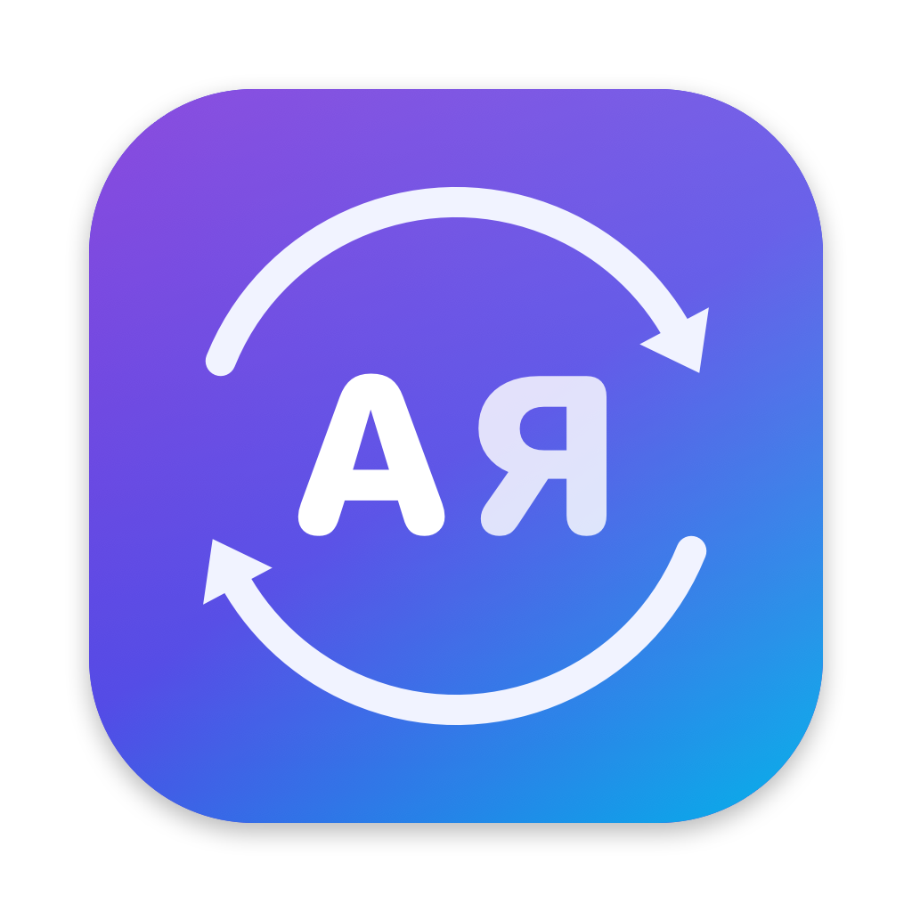

<p align="center"></p>

<h1 align="center">Switchy</h1>

<p align="center">
Исправляет текст, набранный не в той раскладке, — <b>по нажатию</b>, а не автоматически.<br>
Маленькая утилита для строки меню macOS. Никаких словарей, никакой сети, ничего не уходит с вашего Mac.
</p>

<p align="center"><a href="README.md">English</a> · <a href="README.uk.md">Українська</a></p>

---

## Возможности

- **Исправление набранного.** Набрали `ghbdtn` вместо «привет»? Тапните **левый Option** — текст
  перепечатается в нужной раскладке, и раскладка переключится.
- **Умный режим.** Первый тап сам выбирает наиболее вероятную раскладку — по встроенной в macOS проверке
  орфографии и распознаванию языка (на устройстве). Следующие тапы перебирают остальные раскладки,
  исходная — последней.
- **Исправление выделенного.** Выделите текст и тапните ту же клавишу.
- **Прямые хоткеи раскладок.** Свой хоткей на каждую раскладку (например, `⌃⌥1` → English, `⌃⌥2` → Русский
  или F13/F14/F15). Если вы только что что-то набрали — оно заодно переведётся в эту раскладку.
- **Память раскладки по окнам.** У каждого окна своя раскладка — включая переключения самого Switchy.
- **История буфера обмена.** Только текст, панель быстрого выбора у текстового курсора (`⇧⌘V`): цифры 1–9,
  поиск, стрелки. Пароли, помеченные менеджерами паролей как секретные, не сохраняются.
- **Настройки для всего:** хоткеи (сочетания, тапы и двойные тапы модификаторов), порядок раскладок,
  исключения по приложениям, пауза, автозапуск. Интерфейс на английском, русском и украинском.

Работает с любыми раскладками, установленными в macOS, — таблицы строятся из системных данных раскладок.

## Установка

1. Скачайте **Switchy-x.y.z.dmg** на странице [Releases](https://github.com/hdd1/Switchy/releases/latest),
   откройте и перетащите **Switchy** в **Программы**.
2. **Первый запуск.** Switchy бесплатный и не нотаризован Apple (для этого нужен платный аккаунт
   разработчика), поэтому macOS блокирует первый запуск:
   - откройте Switchy → в окне «Не удалось открыть Switchy» нажмите **Готово**;
   - откройте **Системные настройки → Конфиденциальность и безопасность**, прокрутите до раздела
     **Безопасность** и нажмите **Всё равно открыть** рядом с «Switchy заблокирован…», подтвердите паролем /
     Touch ID.

   Или в Терминале: `xattr -dr com.apple.quarantine /Applications/Switchy.app`
3. **Права.** Switchy нужны **Универсальный доступ** и **Мониторинг ввода** (чтобы видеть нажатия и
   перепечатывать текст). Разрешите их по запросу или в **Системных настройках → Конфиденциальность и
   безопасность**. Если Switchy нет в списке — добавьте кнопкой **+** (`/Applications/Switchy.app`).
   Пока прав не хватает, в строке меню рядом с раскладкой виден `⚠︎`.
4. Рекомендуется выключить **Системные настройки → Клавиатура → Источники ввода → Изменить… →
   «Автоматически переключаться на источник ввода документа»** — Switchy сам помнит раскладку окон.

Нужна macOS 15 или новее (Apple Silicon или Intel).

## Хоткеи по умолчанию

| Действие | Хоткей |
|---|---|
| Перевести набранный / выделенный текст | тап **левого Option** |
| Включить раскладку 1, 2, 3… (и перевести только что набранное) | `⌃⌥1`, `⌃⌥2`, `⌃⌥3`… |
| История буфера обмена | `⇧⌘V` |

Все хоткеи меняются в **Настройках** (значок в строке меню → Настройки…).

**Что переводится:** текст, набранный после последнего клика, Enter, Backspace, стрелки, смены окна, смены
раскладки или паузы в наборе (по умолчанию 5 с). Если ничего не набрано — переводится выделение.

## Приватность

Чтобы работать, Switchy должен видеть нажатия клавиш. Он хранит только набранное в текущем поле после
последней границы — в памяти, никогда не на диске. Сетевого кода нет совсем. История буфера обмена хранится
в `~/Library/Application Support/Switchy` (доступ только у вас) — или только в памяти, если это выключить.
Код открыт — проверьте сами.

## Сборка из исходников

Нужен Xcode 16+ (Swift 6).

```bash
git clone https://github.com/hdd1/Switchy.git
cd Switchy
swift test                  # тесты
scripts/build-app.sh --run  # build/Switchy.app и запуск
scripts/install.sh          # собрать и установить в /Applications
scripts/build-dmg.sh        # универсальный релизный DMG
```

Сборка подписывается сертификатом `Apple Development`, чтобы macOS не сбрасывала права при пересборке.
Другой сертификат: `SWITCHY_SIGN_ID="..."`, без сертификата (ad-hoc): `SWITCHY_SIGN_ID=-`.

Переводы — в одной таблице [`scripts/l10n/strings.tsv`](scripts/l10n/strings.tsv): новый язык — новая
колонка; `python3 scripts/l10n/generate.py` собирает файлы и проверяет непереведённые строки.

Windows? См. [docs/WINDOWS-PORT.md](docs/WINDOWS-PORT.md) — полная спецификация Windows-версии.

## Лицензия

[MIT](LICENSE)
