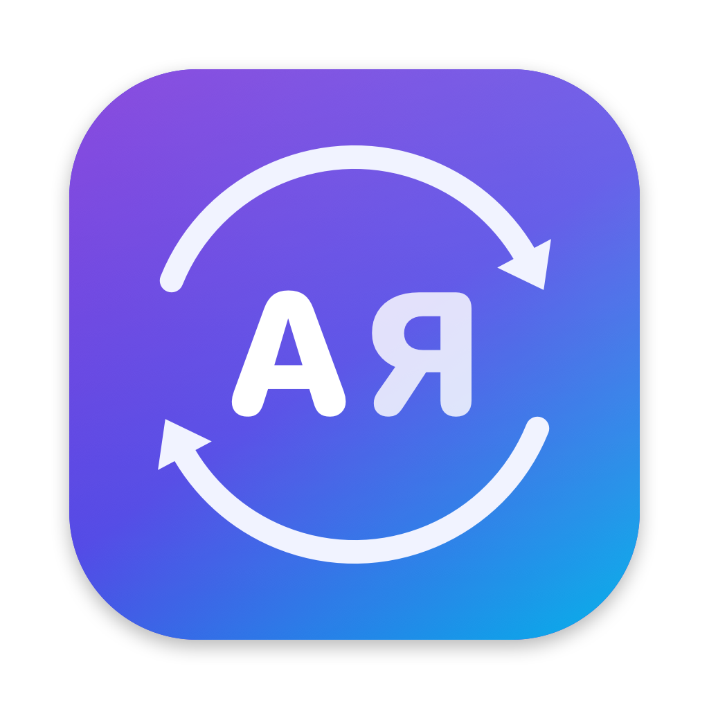

<p align="center"></p>

<h1 align="center">Switchy</h1>

<p align="center">
Виправляє текст, набраний не в тій розкладці, — <b>за натисканням</b>, а не автоматично.<br>
Маленька утиліта для рядка меню macOS. Жодних словників, жодної мережі, нічого не залишає ваш Mac.
</p>

<p align="center"><a href="README.md">English</a> · <a href="README.ru.md">Русский</a></p>

---

## Можливості

- **Виправлення набраного.** Набрали `ghbdsn` замість «привіт»? Тапніть **лівий Option** — текст
  передрукується в потрібній розкладці, і розкладка перемкнеться.
- **Розумний режим.** Перший тап виправляє **лише слова, набрані не в тій розкладці**: `ghbdsn zr cghfdb`
  стане «привіт як справи», а `dev`, `git` чи `commit` поруч залишаться як є. Перевірка — за словником macOS,
  на пристрої; терміни й описки не чіпаються. Наступні тапи перекладають увесь фрагмент по колу, початкова
  розкладка — останньою.
- **Виправлення виділеного.** Виділіть текст і тапніть ту саму клавішу.
- **Прямі гарячі клавіші розкладок.** Своя гаряча клавіша на кожну розкладку (наприклад, `⌃⌥1` → English,
  `⌃⌥3` → Українська або F13/F14/F15). За бажанням — заодно перекладають щойно набране в цю розкладку.
- **Пам'ять розкладки для вікон.** Кожне вікно має свою розкладку — зокрема після перемикань самого Switchy.
- **Історія буфера обміну.** Лише текст, панель швидкого вибору біля текстового курсора (`⇧⌘V`): цифри 1–9,
  пошук, стрілки. Паролі, позначені менеджерами паролів як секретні, не зберігаються.
- **Налаштування для всього:** гарячі клавіші (сполучення, тапи й подвійні тапи модифікаторів), порядок
  розкладок, винятки для застосунків, пауза, автозапуск. Інтерфейс англійською, російською та українською.

Працює з будь-якими розкладками, встановленими в macOS, — таблиці будуються із системних даних розкладок.

## Встановлення

1. Завантажте **Switchy-x.y.z.dmg** на сторінці [Releases](https://github.com/hdd1/Switchy/releases/latest),
   відкрийте та перетягніть **Switchy** у **Програми**.
2. **Перший запуск.** Switchy безкоштовний і не нотаризований Apple (для цього потрібен платний обліковий
   запис розробника), тому macOS блокує перший запуск:
   - відкрийте Switchy → у вікні «Не вдалося відкрити Switchy» натисніть **Готово**;
   - відкрийте **Системні параметри → Конфіденційність і безпека**, прокрутіть до розділу **Безпека** й
     натисніть **Все одно відкрити** біля «Switchy заблоковано…», підтвердьте паролем / Touch ID.

   Або в Терміналі: `xattr -dr com.apple.quarantine /Applications/Switchy.app`
3. **Дозволи.** Switchy потрібні **Універсальний доступ** і **Моніторинг введення** (щоб бачити натискання й
   передруковувати текст). Дозвольте їх за запитом або в **Системних параметрах → Конфіденційність і
   безпека**. Якщо Switchy немає у списку — додайте кнопкою **+** (`/Applications/Switchy.app`).
   Поки дозволів бракує, у рядку меню поруч із розкладкою видно `⚠︎`.
4. Рекомендовано вимкнути **Системні параметри → Клавіатура → Джерела введення → Змінити… →
   «Автоматично перемикатися на джерело введення документа»** — Switchy сам пам'ятає розкладку вікон.

Потрібна macOS 15 або новіша (Apple Silicon чи Intel).

## Гарячі клавіші за замовчуванням

| Дія | Гаряча клавіша |
|---|---|
| Перекласти набраний / виділений текст | тап **лівого Option** |
| Увімкнути розкладку 1, 2, 3… | `⌃⌥1`, `⌃⌥2`, `⌃⌥3`… |
| Історія буфера обміну | `⇧⌘V` |

Усі гарячі клавіші змінюються в **Параметрах** (значок у рядку меню → Параметри…).

**Що перекладається:** текст, набраний після останнього кліку, Enter, Backspace, стрілок, зміни вікна, зміни
розкладки або паузи в наборі (за замовчуванням 5 с). Якщо нічого не набрано — перекладається виділення.

## Приватність

Щоб працювати, Switchy має бачити натискання клавіш. Він зберігає лише набране в поточному полі після
останньої межі — у пам'яті, ніколи на диску. Мережевого коду немає взагалі. Історія буфера обміну
зберігається в `~/Library/Application Support/Switchy` (доступ лише у вас) — або лише в пам'яті, якщо це
вимкнути. Код відкритий — перевірте самі.

## Збирання з вихідного коду

Потрібен Xcode 16+ (Swift 6).

```bash
git clone https://github.com/hdd1/Switchy.git
cd Switchy
swift test                  # тести
scripts/build-app.sh --run  # build/Switchy.app і запуск
scripts/install.sh          # зібрати й встановити в /Applications
scripts/build-dmg.sh        # універсальний релізний DMG
```

Збірка підписується сертифікатом `Apple Development`, щоб macOS не скидала дозволи під час перезбирання.
Інший сертифікат: `SWITCHY_SIGN_ID="..."`, без сертифіката (ad-hoc): `SWITCHY_SIGN_ID=-`.

Переклади — в одній таблиці [`scripts/l10n/strings.tsv`](scripts/l10n/strings.tsv): нова мова — нова
колонка; `python3 scripts/l10n/generate.py` збирає файли й перевіряє неперекладені рядки.

Windows? Див. [docs/WINDOWS-PORT.md](docs/WINDOWS-PORT.md) — повна специфікація Windows-версії.

## Ліцензія

[MIT](LICENSE)
